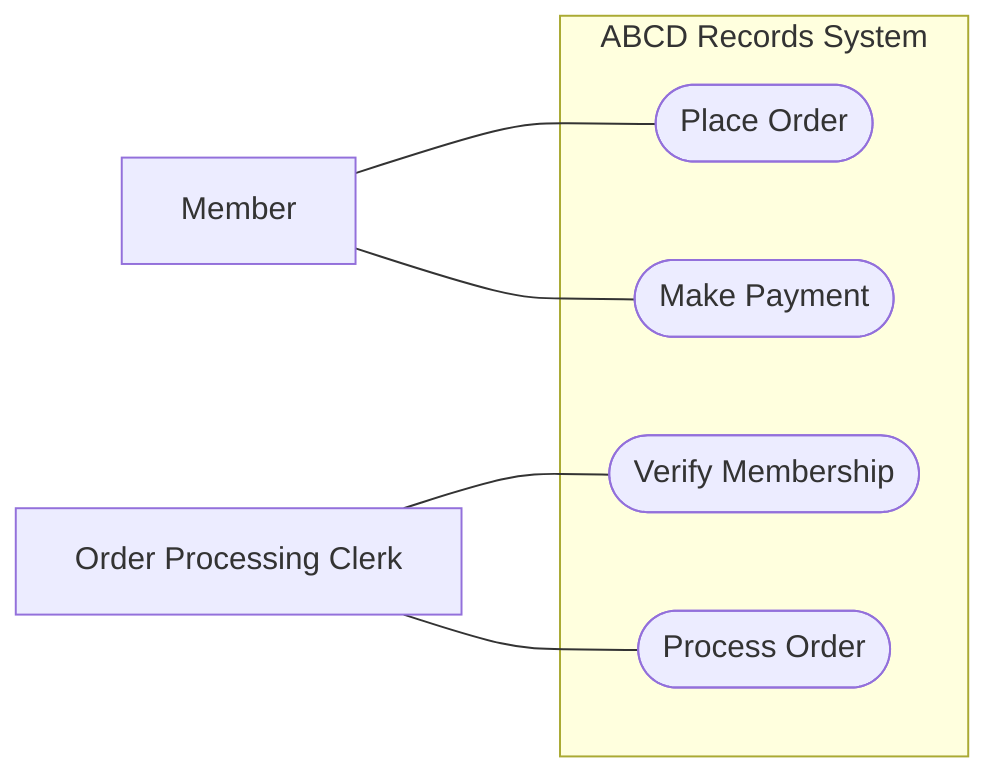
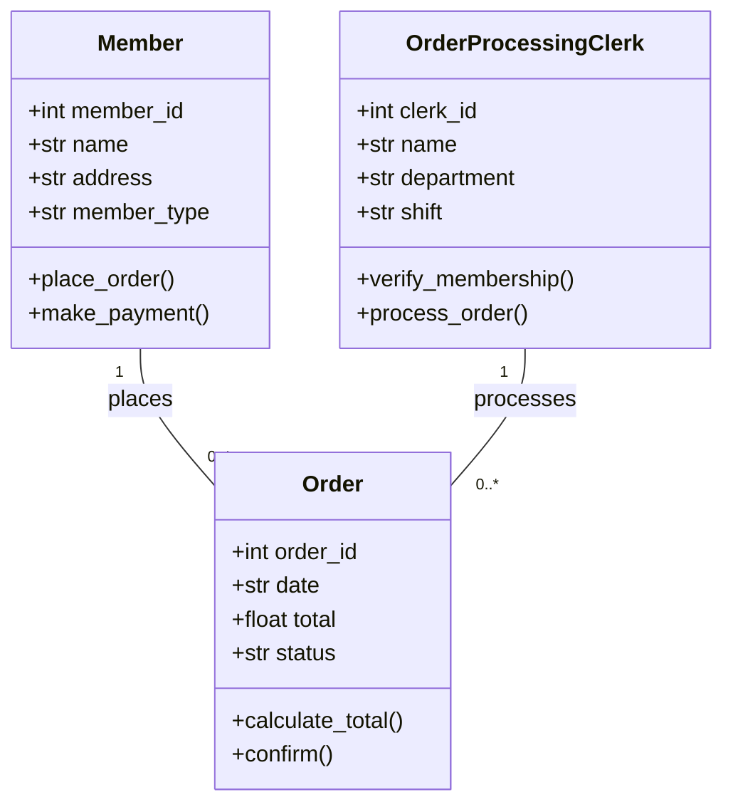
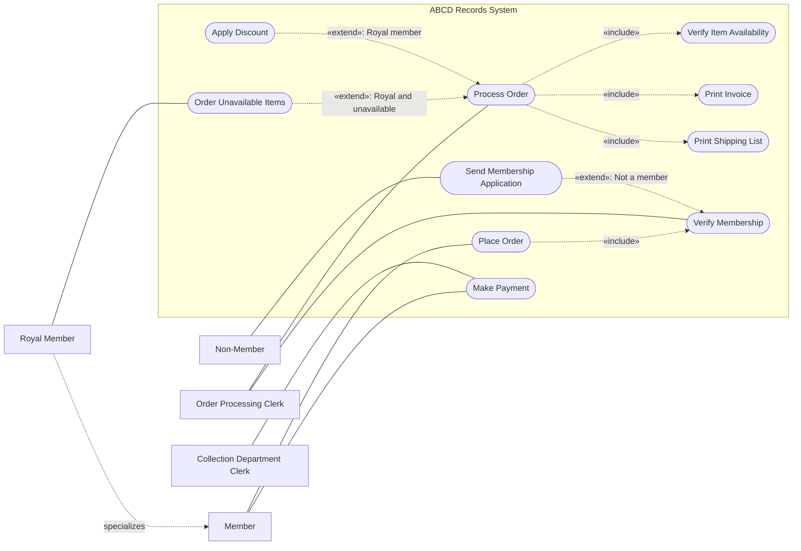
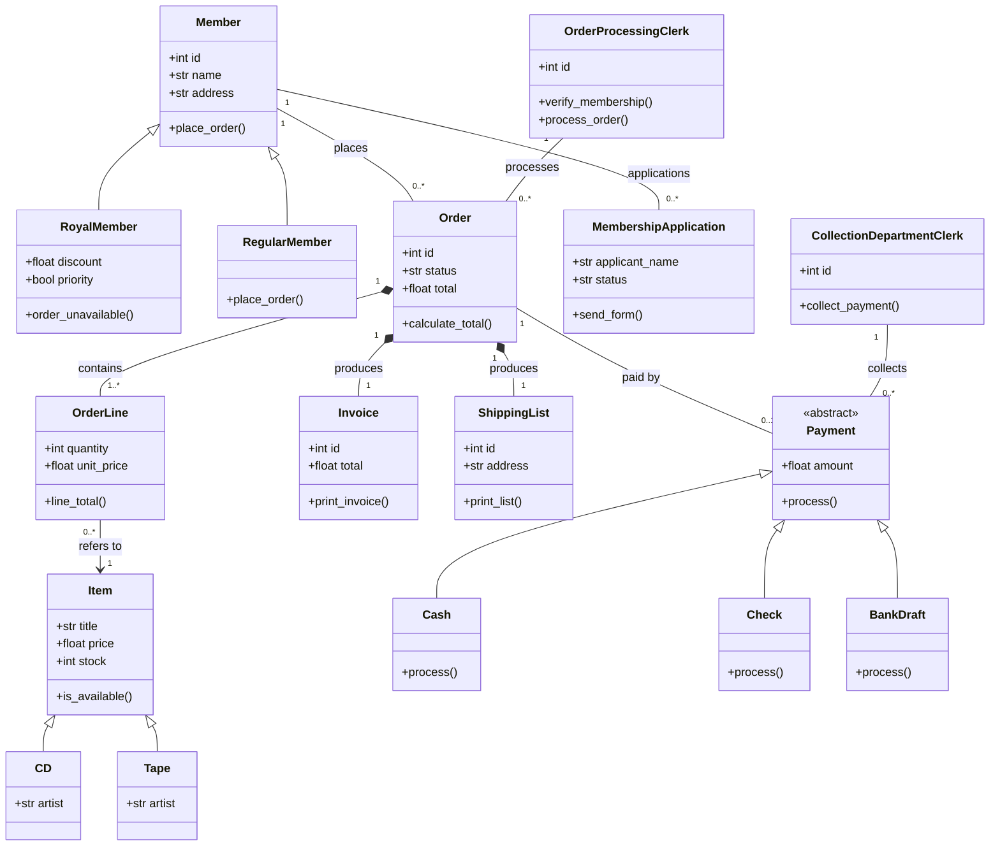
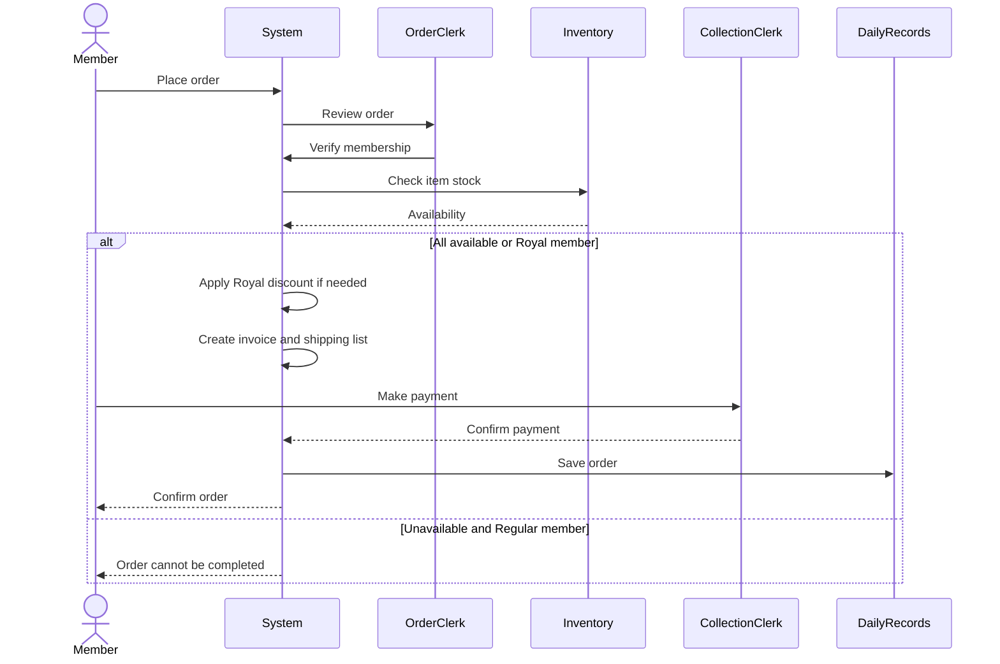
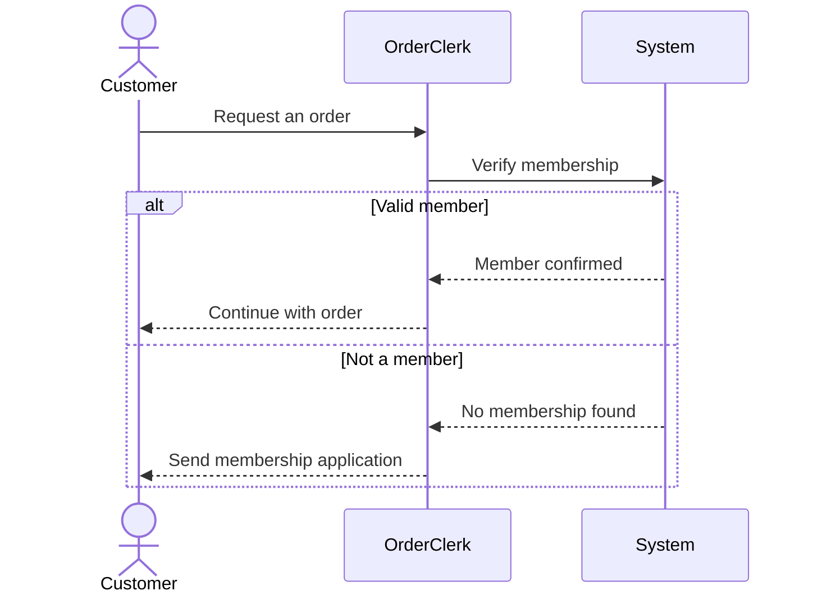
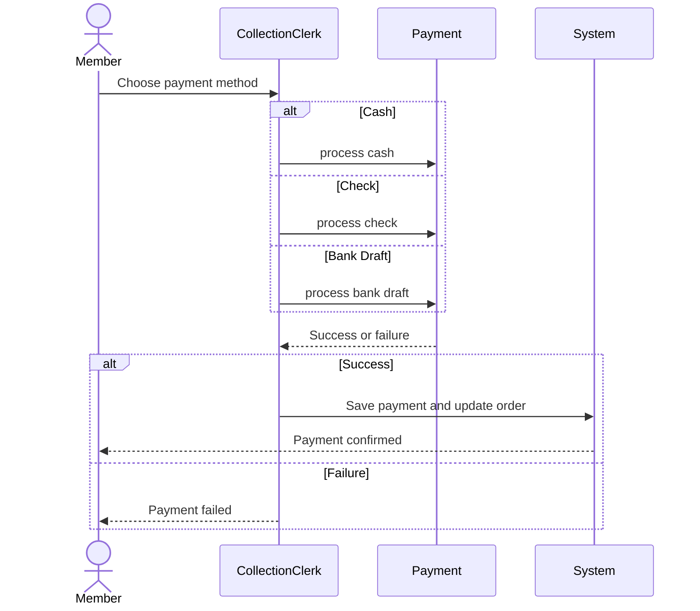
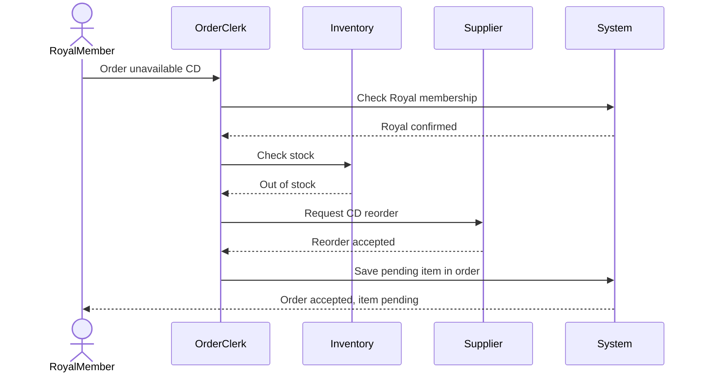

# Exo 2 - ABCD Records

## Level 1 - Task 1.1: basic use case diagram

The boxes and arrows show the actors and their actions. This is a simple use case view made with Mermaid.

## Level 1 - Task 1.2: basic class diagram

## Level 2 - Task 2.1: complete use case diagram

Mermaid does not have a native UML use case diagram type, so this flowchart uses a system boundary, actor boxes, and labelled `«include»` / `«extend»` relations. It is a readable approximation rather than a formal UML use case drawing.

## Level 2 - Task 2.2: complete class diagram

`RoyalMember` and `RegularMember` inherit from `Member`. Different payment methods inherit from `Payment`. CDs and tapes inherit from `Item`. An order owns its order lines.

## Level 2 - Example: Royal member orders two CDs

A Royal member orders two CDs. One is in stock and the other is not. The system accepts the unavailable CD because this member is Royal. The clerk applies the Royal discount, prepares an invoice, and accepts a check payment.

## Level 3 - Sequence 1: complete order processing

## Level 3 - Sequence 2: membership verification

## Level 3 - Sequence 3: payment processing

## Level 3 - Sequence 4: reorder unavailable item for Royal member

