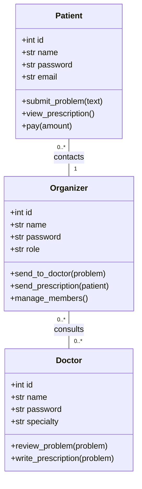
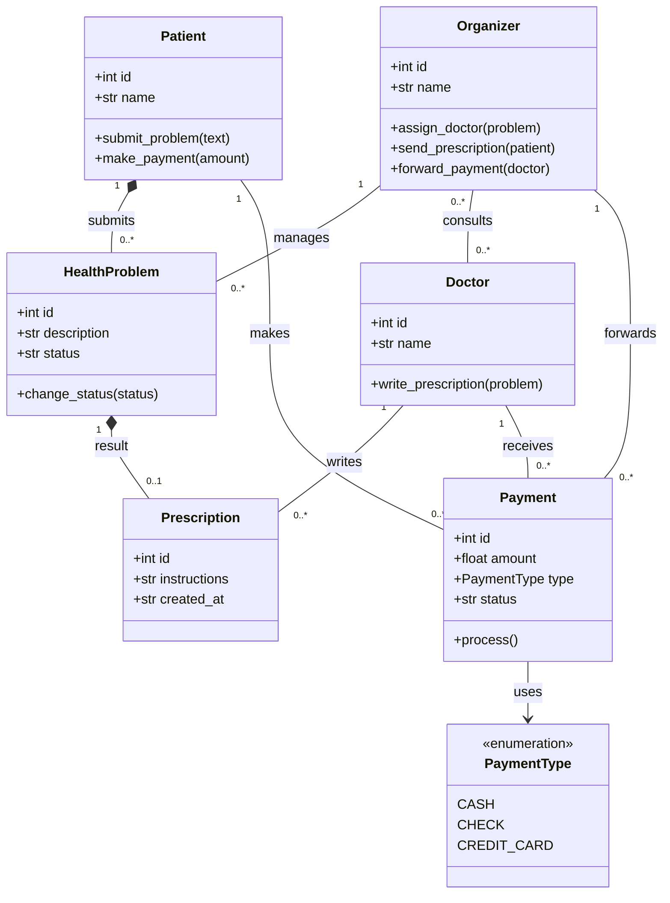
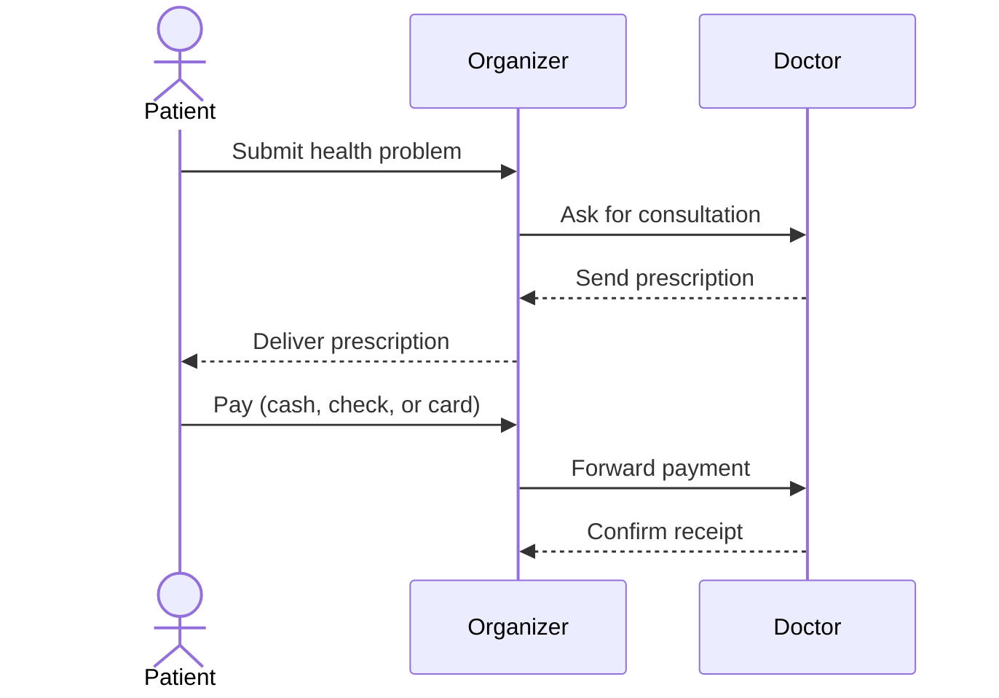
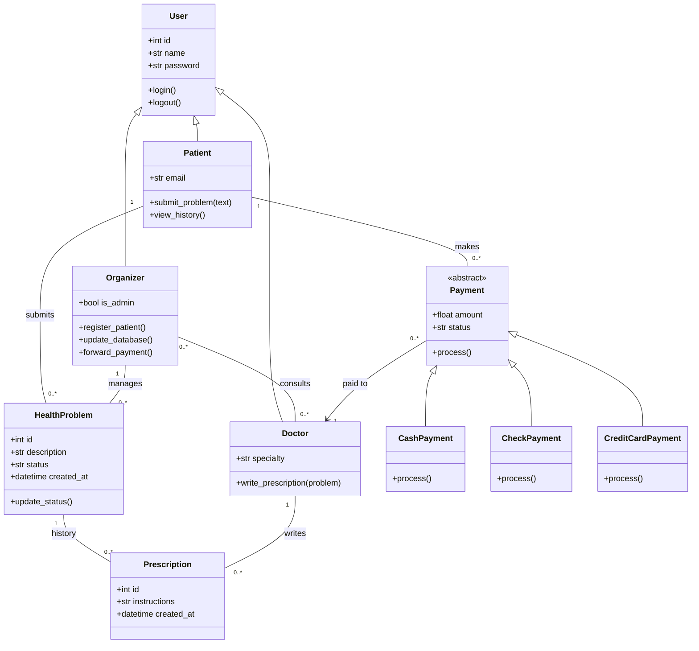
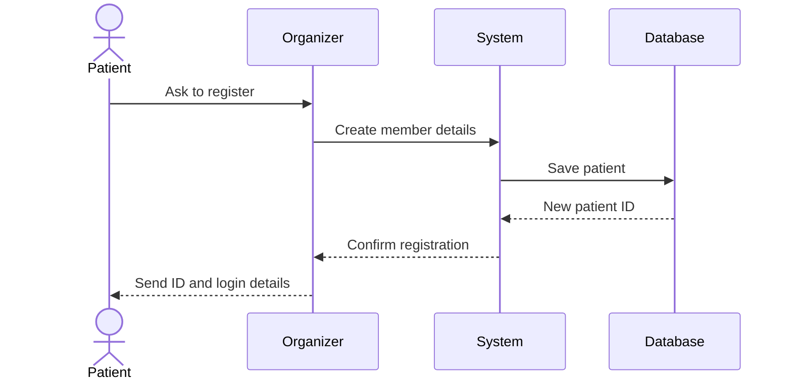
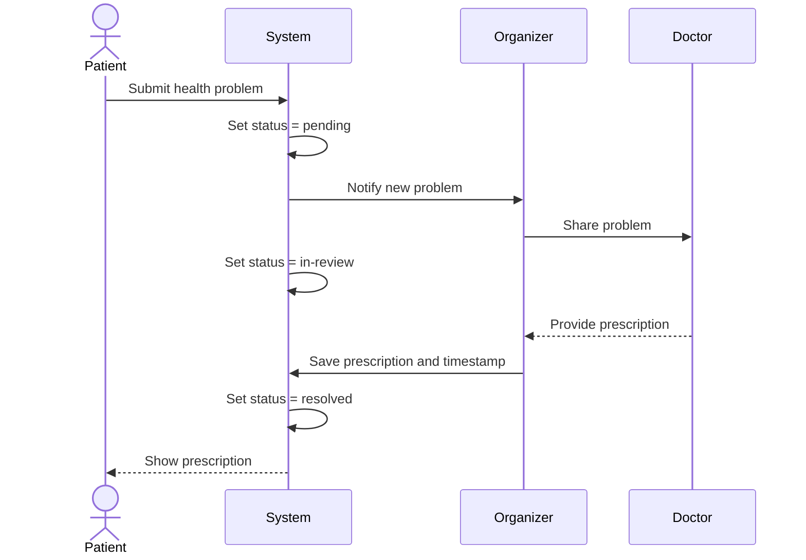
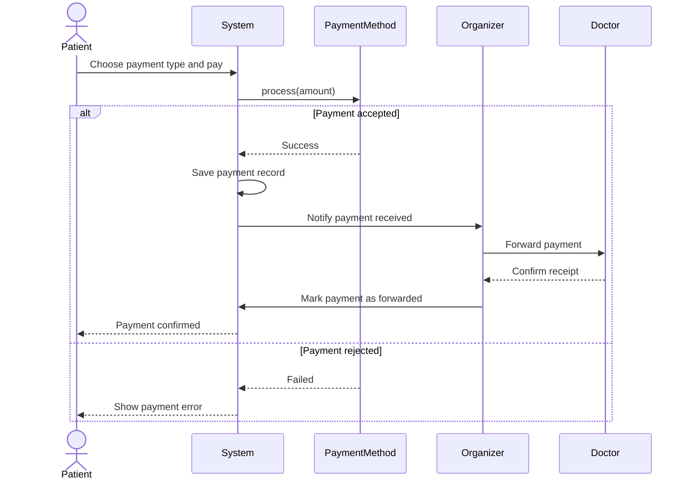

# Exo 1 - Hospital Management System

## Task 1 - Basic class diagram

The three main roles are Patient, Doctor, and Organizer. The organizer connects patients and doctors.

## Task 2 - Full class diagram

The design has the six requested classes. The `PaymentType` enumeration stores the three payment methods. A patient can submit many health problems. One problem can have zero or one prescription in this simple version.

## Task 2 - Sequence diagram: consultation and payment

## Task 3 - Advanced class design

All people share basic information in the `User` superclass. A problem has a status and a creation time. A patient can see previous prescriptions. Payment types use different implementations of `process()`.

## Task 3 - Sequence 1: patient registration

## Task 3 - Sequence 2: consultation flow

## Task 3 - Sequence 3: payment processing

